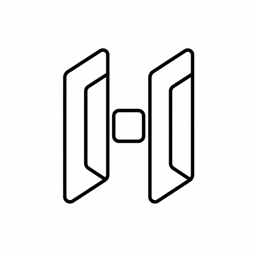

<p align="center">
  
</p>

<h1 align="center">H0x Video Studio</h1>

<p align="center">
  A desktop studio for AI images and video, where you build the shot before you generate it.
</p>

<p align="center">
  <a href="https://github.com/buckleson/h0x-video-studio/actions/workflows/ci.yml"></a>
  <a href="https://github.com/buckleson/h0x-video-studio/releases"></a>
</p>

---

## What it does

Prompts alone rarely give you the exact frame you want. H0x Video Studio lets you set it up first, then generate.

- **Stage in 3D.** Place characters, props and backdrops, pose them, and set the camera.
- **Compose in 2D.** Layer images, cut out subjects, draw masks and paint where a change should go.
- **Generate images and video.** Pick the model that fits the job, from text, from an image, or from your staged scene.
- **Turn images into assets.** Make 3D meshes and environments from pictures and reuse them across shots.
- **Edit the result.** Trim and arrange clips on a timeline without leaving the app.

## Download

Installers for **Windows**, **macOS** and **Linux** are on the [Releases](https://github.com/buckleson/h0x-video-studio/releases) page.

> The macOS build is not signed yet. The first time, right-click the app and choose **Open**.

## Build from source

You need:
- **Node.js** 20 or newer (24 recommended)
- **Rust** (stable, via [rustup](https://rustup.rs))
- On Linux, the [Tauri system packages](https://v2.tauri.app/start/prerequisites/)

```bash
git clone https://github.com/buckleson/h0x-video-studio.git
cd h0x-video-studio/frontend
npm ci
cd ..
```

Run the app in development mode (macOS and Linux):

```bash
./script/artcraft/unix_dev.sh
```

On Windows, run `script/artcraft/windows_frontend_dev.ps1` and `script/artcraft/windows_rust_dev.ps1` in two terminals.

Check and test the Rust side (SQLite queries are cached, so no database is needed):

```bash
SQLX_OFFLINE=true cargo check --workspace
```

Run the frontend tests:

```bash
cd frontend && npx nx run-many -t test --skip-sync
```

## Project layout

| Path | What is there |
|---|---|
| `crates/desktop/` | The desktop app (Tauri 2, Rust) |
| `crates/api_clients/` | Clients for the generation providers |
| `crates/lib/` | Shared Rust libraries |
| `frontend/apps/` | The app UI (React, Vite, Tailwind) |
| `frontend/libs/` | UI components and shared TypeScript libraries |
| `_database/` | SQLite migrations |

## Releases

Pushing a tag like `v0.1.0` builds all three installers in GitHub Actions and attaches them to a draft release.

## Credits

Secured by HyperOx · Powered by [Buckleson](https://buckleson.com) · Managed by [Pavi](https://pavi.tech)

## License

MIT or Apache-2.0, at your option. See [LICENSE-MIT](LICENSE-MIT), [LICENSE-APACHE](LICENSE-APACHE) and [NOTICE](NOTICE) for the original authors' copyright and third-party attributions.
